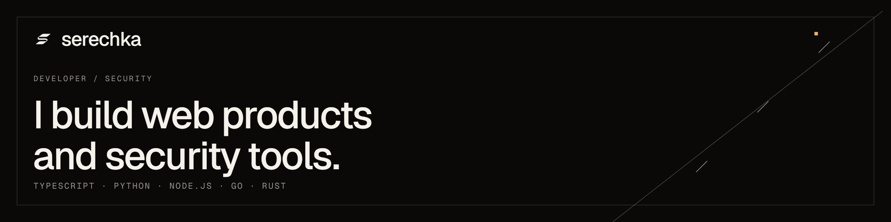

  

I build web products and security tooling. TypeScript and Next.js on the front, Python and Node.js on the back, Go and Rust for tools.

I also take on authorized security assessments and penetration testing.

Currently building **Arguscan**, a passive website security scanner and Telegram bot.

## Stack

| | |
| --- | --- |
| Frontend | TypeScript · Next.js · React |
| Backend | Python · Node.js |
| Systems | Go · Rust |
| Other | Java · SQLite |

## Selected work

| Project | About | Stack |
| --- | --- | --- |
| [Arguscan](https://t.me/arguscanbot) | Passive website security scanner and Telegram bot | Python |
| [serechka.dev](https://serechka.dev) | Site for independent security assessments | Next.js · TypeScript |
| [aiorollypay](https://github.com/serechka/aiorollypay) | Dependency-free Go client for the RollyPay payment API | Go |
| [HeartsPlus](https://github.com/serechka/HeartsPlus) | Client-side health indicators for Minecraft, Fabric and NeoForge | Java |

## Contact

[Website](https://serechka.dev) · [Telegram](https://t.me/serechka) · [Email](mailto:mail@serechka.dev)
