  

# serechka

Независимый аудит безопасности и пентест.

Провожу согласованные проверки безопасности: сайты, API, приложения, код, бинарники и файлы. Подтверждаю проблемы, объясняю влияние на бизнес и даю рекомендации по исправлению.

Вы общаетесь напрямую со специалистом, который проводит проверку и пишет отчёт.

## Что проверяю

- Сайты и веб-приложения
- API
- Приложения
- Код
- Бинарники и файлы

## Как смотрю

Смотрю систему как атакующий: ищу цепочку, а не отдельные пункты чек-листа. Проверяю интерфейс, логику, доступ, данные и интеграции.

## Контакты

- Сайт: https://serechka.dev
- Telegram: https://t.me/serechka
- Канал: https://t.me/serechka_dev
- Почта: mail@serechka.dev

## Проекты

- [Arguscan](https://t.me/arguscanbot) - бот пассивной проверки безопасности сайта. Показывает оценку риска, защиту и найденные проблемы. Одна проверка в сутки.
- [aiorollypay](https://github.com/serechka/aiorollypay) - Go.
- [HeartsPlus](https://github.com/serechka/HeartsPlus) - полоски здоровья над игроками для Fabric и NeoForge.

## Бесплатная проверка

Пришлите домен боту [@arguscanbot](https://t.me/arguscanbot). Он проверит публичные страницы и покажет оценку риска.
